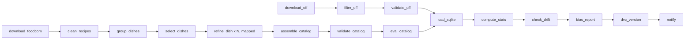
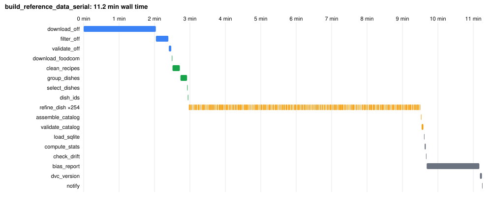
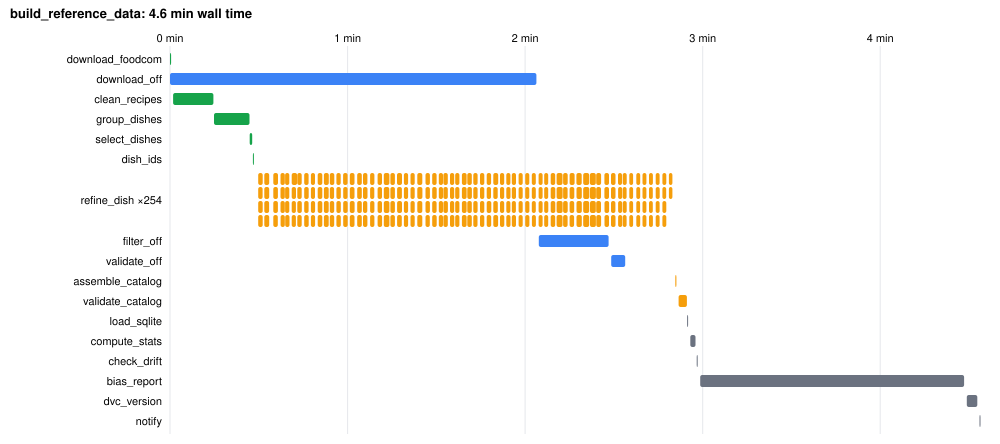

# Pantry Path data pipeline

The data side of Pantry Path. A user names a dish, a ZIP code, allergies and a diet. The pipeline answers with `result.json`: the dish's ingredients, the nearest grocery stores, and for each ingredient the store products that are **safe**, **unsafe** or **unknown** for that user, each with a reason.

It has two parts that share one codebase:

- **`build_reference_data`** (weekly Airflow DAG) builds the reference data:
  - a **dish catalog**: 100 dishes with ingredients, from Food.com recipes refined by an LLM
  - an **allergen snapshot**: ~410k US products with English ingredient lists or allergen tags, from Open Food Facts

  It also validates both, scores the catalog against held-out reference recipes, computes statistics, checks drift and outliers, writes a bias report (with a held-out check of the diet rules), versions the outputs with DVC and sends alerts.
- **The request flow** (terminal command, Python function, or the `serve_request` DAG) turns one request into `result.json` in a few seconds, using live Kroger data.

**Docs:**
- **Teammates who only consume the output:** [`docs/data-pipeline-handoff.md`](../docs/data-pipeline-handoff.md)
- **Results and findings:** [`docs/data-pipeline-report.md`](../docs/data-pipeline-report.md) (also as a PDF)
- **The design and its reasons:** [`docs/superpowers/specs/2026-10-24-data-pipeline-design.md`](../docs/superpowers/specs/2026-10-24-data-pipeline-design.md)
- **Where each grading criterion is met:** [section 11](#11-how-this-meets-the-assignment)

**Quick start** (details in [section 1](#1-replicate-the-pipeline-airflow-in-docker)):
```bash
git clone https://github.com/Khushal070/Pantry-Path.git && cd Pantry-Path && cp .env.example .env
cd data-pipeline && docker compose up -d --build
# open http://localhost:8080 (airflow / airflow) and switch on build_reference_data
```



---

## 1. Replicate the pipeline (Airflow in Docker)

**You need:**
- **Docker Desktop with 8 GB of memory** for Docker (Settings → Resources; tested with 8 GB).
- **About 12 GB of free disk.** The 8 GB Open Food Facts dump is deleted after filtering.
- **git.**
- **No API keys** for the batch pipeline. A Kroger key is needed only for requests (section 2).

**Steps:**
1. **Clone the repo and create your `.env`.** Every key in it is optional for the batch pipeline (see the table below).
   ```bash
   git clone https://github.com/Khushal070/Pantry-Path.git
   cd Pantry-Path
   cp .env.example .env
   ```
   Linux only: also run `echo "AIRFLOW_UID=$(id -u)" > data-pipeline/.env`, so files written by Airflow stay owned by you.
2. **Start Airflow.** The first build takes about 5 minutes.
   ```bash
   cd data-pipeline
   docker compose up -d --build
   docker compose ps          # wait until the services show "healthy"
   ```
   Then open **http://localhost:8080** and log in with `airflow` / `airflow`.
3. **Switch on `build_reference_data`** (DAGs start paused). It starts a run on its own, so don't also trigger it.
4. **Wait for every task to turn green.** That's about 5 minutes, plus the Open Food Facts download (8 GB from Hugging Face; about 2 minutes on a fast connection).

**What happens on the way:**
- **`download_off` → `filter_off`** fetch Open Food Facts and keep the US products that have ingredient or allergen data.
- **`download_foodcom`** gets the Food.com recipes from Kaggle (no account needed).
- **`pull_llm_cache`** downloads our saved LLM replies from the public bucket (no login).
  - The catalog's LLM step was run **once**, with Claude Opus 5.5, for $6.08.
  - `refine_dish` replays those replies, so **you need no LLM key and it costs nothing**. The catalog comes out identical to ours.
- **`dvc_version`** logs the warning "DVC push skipped: read-only". That's expected: only the project owner can upload new data versions.

**What you should see** (paths relative to `data-pipeline/`):

| Check | Expected |
|---|---|
| Airflow | Every task in the `build_reference_data` run is green (272 task instances, 254 of them mapped `refine_dish` tasks) |
| `reports/catalog_summary.json` | 100 dishes: 60 American, 10 European, 10 Latin American, 10 East/SE Asian, 5 South Asian, 5 Middle Eastern/African, no shortfalls |
| `reports/llm_usage.json` | `"calls_real": 0`, `"calls_cached": 254`: no LLM was called |
| `reports/stats.json` | About 410k Open Food Facts products (it grows a little; Open Food Facts updates daily) |
| `reports/catalog_eval.md` | Ingredient recall 91.1% on the dev recipes and 89.8% on the held-out test recipes (the catalog is identical, so these match) |
| `reports/ge/`, `reports/drift.json`, `reports/outliers.json`, `reports/bias_report.md` | Regenerated by your run |
| Gantt chart | Airflow UI → `build_reference_data` → the run → **Gantt** |

**Faster variant:** to skip the 8 GB download, set `off.source: dvc` in `config/pipeline.yaml` (line 16). `download_off` then pulls our filtered 30 MB snapshot from the public bucket instead.

**Other DAGs:**
- **`build_reference_data_serial`:** the same pipeline with no parallelism, for the Gantt comparison. Trigger it by hand, and not while `build_reference_data` is running, since they share files.
- **`serve_request`:** see section 2.

**Stop Airflow:** `docker compose down`. Add `-v` to also delete Airflow's database. The repo is mounted into the containers, so data, reports and logs appear on your machine as they're written.

**`.env` (repo root, never committed).** Each task reads it when it starts, so there's no need to restart Airflow after editing it.

| Variable | Needed for | Without it |
|---|---|---|
| `KROGER_CLIENT_ID`, `KROGER_CLIENT_SECRET` | Requests (section 2) | The batch pipeline runs fine; requests can't |
| `LLM_API_KEY` (+ optional `LLM_PROVIDER`, `LLM_MODEL`) | Only dishes the saved replies don't cover: new dishes at request time, or a changed prompt. Any provider works: Anthropic, Gemini or OpenAI | The saved replies are replayed |
| `REDCIRCLE_API_KEY` | Optional Target fallback in requests | Kroger only |
| `ALERT_SMTP_USER`, `ALERT_SMTP_PASSWORD`, `ALERT_EMAIL_TO` | Emailing alerts to your own inbox: a Gmail address, its app password, and where alerts go (set all three; see section 6). Left empty, sender and recipient are the project address in `config/pipeline.yaml` | Alerts are logged only |

## 2. Run a request

**You need:**
- **A finished `build_reference_data` run.** It builds the dish catalog and the allergen snapshot.
- **Kroger API credentials.** Create a free app at [developer.kroger.com](https://developer.kroger.com) with the Products and Locations APIs, then set `KROGER_CLIENT_ID` and `KROGER_CLIENT_SECRET` in the repo-root `.env`.

**In Airflow:** switch on **`serve_request`**, then use **Trigger DAG** with this config:
```json
{"dish": "quiche", "zip": "45202", "avoid": ["milk", "gluten"], "diet": "vegetarian"}
```
The result is written to `data-pipeline/results/result_<run id>.json`. It's temporary by design and expires after 24 h.

**From a terminal** (the same code, inside the container):
```bash
docker compose exec airflow-scheduler bash -c "cd /opt/pantrypath/data-pipeline && /opt/pipeline-venv/bin/python -m pantrypath_pipeline.request 'quiche' --zip 45202 --avoid milk gluten --diet vegetarian"
```

**From Python** (the backend): `pantrypath_pipeline.request.build_result(cfg, query, zip_code, avoid, diet)`. See [`docs/data-pipeline-handoff.md`](../docs/data-pipeline-handoff.md).

**Dishes not in the catalog** are built on the fly by the LLM. That needs `LLM_API_KEY`, and costs about $0.03 per new dish with Claude Opus 5.5.

Measured on 2026-10-25:

| Request | Result | Time | Calls |
|---|---|---|---|
| "quiche", 45202, avoid milk + gluten, vegetarian | quiche lorraine: 3 Kroger stores, 12 ingredients, 180 products (39 safe, 114 unsafe, 27 unknown) | 5.3 s | 38 Kroger |
| "pad thai", 45202, avoid peanuts + shellfish (via the `serve_request` DAG) | 3 Kroger stores + 1 Target (fallback), 18 ingredients, 16 with a safe product (none for peanuts and shrimp, as expected) | 20.2 s | 56 Kroger + 4 Target |

## 3. Steps

Every step is a CLI command (`python -m pantrypath_pipeline <step>`). The Airflow tasks, `scripts/run_all.sh` and you all run the same code. Each prints a JSON summary as its last line, which Airflow keeps as the task's XCom.

| Step | Module | Reads | Writes |
|---|---|---|---|
| `download-off` | `acquire/off.py` | Hugging Face `openfoodfacts/product-database` | `data/raw/off/food.parquet` (8 GB) |
| `filter-off` | `preprocess/off_filter.py` | raw dump | `data/processed/off_products.parquet` (US products with evidence, English ingredient text only, GTIN-13 barcodes, cleaned text); deletes the raw dump |
| `validate-off` | `validate/expectations.py` | snapshot | `reports/ge/off_*.json` |
| `download-foodcom` | `acquire/foodcom.py` | Kaggle `irkaal/foodcom-recipes-and-reviews` | `data/raw/foodcom/recipes.parquet` |
| `clean-recipes` | `preprocess/recipes.py` | raw recipes | `data/interim/recipes_clean.parquet` |
| `group-dishes` | `preprocess/dishes.py` | clean recipes | `data/interim/dish_candidates.parquet` |
| `select-dishes` | `preprocess/dishes.py` | candidates | `data/interim/dish_pool.json` (popular dishes per cuisine + golden-set dishes) |
| `pull-llm-cache` | `versioning.py` | the DVC remote (public bucket) | `data/processed/llm_cache/` (the saved LLM replies) |
| `refine-dish` / `refine-all` | `refine.py`, `llm.py` | pool, `prompts/refine_dish.txt` | `data/interim/refined/<dish>.json`, `data/processed/llm_cache/` |
| `assemble-catalog` | `catalog_build.py` | refined dishes | `data/processed/dish_profiles.json`, `reports/catalog_summary.json` |
| `validate-catalog` | `validate/expectations.py` | catalog | `reports/ge/catalog_*.json` |
| `eval-catalog` | `evaluate.py` | catalog + `../data/golden/` reference recipes | `reports/catalog_eval.md`, `reports/catalog_eval.json` |
| `load-sqlite` | `store.py` | catalog | `data/processed/pantrypath.sqlite` |
| `compute-stats` | `validate/stats.py` | snapshot + catalog | `reports/stats.json`, `reports/outliers.json` |
| `check-drift` | `validate/drift.py` | this run's vs the previous run's stats | `reports/drift.json` |
| `bias-report` | `bias.py` | snapshot + catalog + `data/eval/` seen barcodes | `reports/bias_report.md`, `reports/bias_report.json` |
| `freeze-seen-products` (by hand, not in the DAG) | `bias.py` | snapshot | `data/eval/diet_rules_seen_barcodes.parquet` (in git) |
| `dvc-version` | `versioning.py` | processed outputs | `.dvc` pointer files; pushes to the remote |
| `notify` | `notify.py` | reports | a run summary (log + email) |

## 4. Code structure

```
shared/                         installable package used by the pipeline AND the backend
  pantrypath_core/
    catalog.py                  dish catalog models (DishProfile, Cuisine, Role)
    diet_rules.py               allergen + diet verdicts (safe / unsafe / unknown)
    barcodes.py                 GTIN-13 normalization (Kroger UPC -> GTIN-13)
    result.py                   result.json v1.0 models
    schema.py                   recipe model with quantities (golden set)
  tests/
data-pipeline/
  dags/                         build_reference_data (+ _serial), serve_request
  config/pipeline.yaml          every setting: paths, quotas, thresholds, models, providers
  prompts/refine_dish.txt       the fixed LLM prompt (versioned)
  scripts/run_all.sh            whole batch without Airflow
  src/pantrypath_pipeline/
    cli.py                      step runner (one command per step)
    config.py errors.py logging_setup.py alerts.py notify.py
    acquire/                    downloads with retries + integrity checks
    preprocess/                 cleaning, grouping, filtering
    llm.py refine.py catalog_build.py store.py
    validate/                   Great Expectations suites, stats + outliers, drift
    bias.py                     data slicing with Fairlearn (+ held-out product check)
    evaluate.py                 catalog vs reference recipes (dev + held-out test)
    providers/                  store plug-ins: Kroger, Target (RedCircle)
    off_lookup.py request.py    the request flow
    versioning.py               dvc add + push
    gantt.py                    Gantt charts + timing summary from Airflow's REST API
  tests/                        pytest, one file per module
  data/{raw,interim,processed}  raw + interim are local only; processed is tracked by DVC
  data/eval/                    barcodes diet_rules was tuned on (in git; defines the held-out set)
  reports/                      quality, drift, bias, LLM usage, Gantt charts (in git)
  logs/                         pipeline.log + Airflow task logs (not in git)
  results/                      request outputs (temporary, not in git)
  Dockerfile docker-compose.yaml dvc.yaml requirements.in requirements.txt pyproject.toml
```

## 5. Data versioning (DVC) and reproducibility

- **Tracked by DVC:** `off_products.parquet`, `dish_profiles.json`, `pantrypath.sqlite`, `llm_cache/`. The `dvc_version` task runs `dvc add` + `dvc push`; Git holds the small `.dvc` pointer files. The DAG never commits: review and commit the pointers yourself, so every data version sits next to the code that produced it.
- **Not versioned:** the raw downloads (re-downloadable; Food.com's license is unverified, so it isn't redistributed) and `data/interim/` (rebuilt from raw).
- **Remotes** (in `.dvc/config`), both pointing at the same bucket `gs://pantry-path-dvc` (GCP project `pantry-path`, us-east1):
  - `pantrypath-public`, `https://storage.googleapis.com/pantry-path-dvc/dvcstore`: the default. Anyone can `dvc pull` over plain HTTPS with no Google login. A `gs://` pull without credentials stalls, which is why this remote exists.
  - `pantrypath-gcs`, `gs://pantry-path-dvc/dvcstore`: for pushing. Only the service account `pantrypath-dvc@pantry-path.iam.gserviceaccount.com` can write. The owner's machine points DVC at its key (kept outside the repo) and makes this remote the local default:
    ```bash
    dvc remote modify --local pantrypath-gcs credentialpath ~/.config/gcp-keys/pantrypath-dvc.json
    dvc remote default --local pantrypath-gcs
    ```
    The key folder is mounted into the Airflow containers at the same path, so the DAG's `dvc_version` step pushes with the same settings. Clones without the key skip the push with a warning. A $5 budget alert guards the bucket's cost (expected ~$0).
- **Comparing versions:** `dvc metrics show` and `dvc metrics diff HEAD~1` compare `reports/stats.json` between commits (row counts, null rates, cuisine counts...).
- **Pinned environment:** `requirements.txt` is generated from `requirements.in` with exact versions for every platform (`uv pip compile requirements.in --universal --python-version 3.12 -o requirements.txt`). The Docker image is pinned to Airflow 3.3.2 / Python 3.12.
- **Deterministic LLM step:**
  - Every LLM reply is cached under `data/processed/llm_cache/`, keyed by a hash of the prompt and schema (not the provider), and versioned with DVC.
  - The `pull_llm_cache` task fetches the cache before `refine_dish`, so every run replays it and gets the identical catalog without an LLM key.
  - Temperature can't provide this: current Claude models don't accept a temperature setting.
- **Refreshing the data (owner):**
  - **What a refresh changes:** the weekly schedule refreshes the Open Food Facts snapshot. The catalog's prompts don't change (Food.com is a fixed 2020 dataset), so every refresh replays the saved replies for $0.
  - **Changed dish list or prompt:** only the new prompts go to the LLM, which needs `LLM_API_KEY`.
  - **Rebuilding the catalog from scratch:** delete `data/processed/llm_cache/` and set `LLM_API_KEY`. That's about 254 calls (about $6 with Claude Opus 5.5), and the result will differ slightly from ours.
  - **After a run with new data:** commit the changed `.dvc` pointers.

## 6. Data quality, anomalies and alerts

- **Schema and quality checks (Great Expectations 1.x):** `validate/expectations.py` runs suites on both outputs. Examples: barcode present, unique and 13 digits; every product has ingredients or allergen tags; row count in the expected range; dish count and cuisine quotas; at least 3 ingredients and 1 core per dish; categories from the allowed list; shares between 0 and 1. Each check is tagged critical (fails the run) or warning (alert only). Results: `reports/ge/`.
- **Statistics:** `reports/stats.json`, numbers only so `dvc metrics diff` can compare runs: row counts, null and evidence rates, allergen coverage, popularity tiers, cuisine counts, ingredients per dish, LLM-added share.
- **Outliers:** ingredients per dish, recipes per dish and ingredient-statement length are checked with an IQR rule (on a log scale for the skewed ones). Offenders go to `reports/outliers.json` with a warning alert.
- **Drift:** `reports/drift.json` compares each run with the previous one. A row-count change over 10% or a rate shift over 5 points is a warning; a row-count change over 30% fails the run.
- **Alerts:** always logged, and emailed to the address in `alerts.email_to` (`config/pipeline.yaml`) with the subject `[Pantry Path pipeline] LEVEL: what happened`. A failed task alerts through the DAG's failure callback. We tested both kinds on 2026-10-26: the outlier check emailed "WARNING: 94 outlier(s) found", and a step run with a missing input emailed "ERROR: step check-drift failed". Sending needs a Gmail app password in `.env`. Without one, alerts are only logged, with a note saying so, and the run carries on.
  - **To get the alerts in your own inbox:** turn on 2-Step Verification for a Gmail account, create an app password at https://myaccount.google.com/apppasswords, and set three values in the repo-root `.env`: `ALERT_SMTP_USER` (that Gmail address), `ALERT_SMTP_PASSWORD` (the app password) and `ALERT_EMAIL_TO` (where alerts should go). They override the project addresses in the config.

## 7. Bias detection and mitigation

See [`reports/bias_report.md`](reports/bias_report.md), generated from the real data by `bias.py` with Fairlearn's `MetricFrame`.

- **Catalog:** a plain top 100 Food.com dishes would be almost all American or untagged. Cuisine quotas (60 / 10 / 10 / 10 / 5 / 5) fix the mix.
- **Diet rules** (the classifier we evaluate, since no model is trained in this assignment): we slice products by category, store vs national brand, and popularity. For each slice we compare the unknown rate and the accuracy against Open Food Facts' own vegan / vegetarian / gluten-free labels, which are used for evaluation only. The mitigation is reading the ingredient text when tags are missing; the report shows before vs after and the trade-offs.

### Held-out evaluation

Both things the pipeline decides are also scored on data nobody looked at while building them:

- **Dish catalog vs reference recipes** (`eval-catalog`, [`reports/catalog_eval.md`](reports/catalog_eval.md)). `../data/golden/recipes.json` is the dev split: 16 recipes we used while building the pipeline. `../data/golden/recipes_heldout.json` is the test split: 27 recipes for other catalog dishes, written on 2026-10-26 after the catalog was frozen (it is replayed from saved LLM replies, so they can't have shaped it). The name matcher was tuned on dev only. Results: ingredient recall **91.1% dev, 89.8% held out**; without the LLM's additions, 87.9% and 86.4%. Held-out recall under 75% alerts.
- **Diet rules on new products** (held-out section of `reports/bias_report.md`). The rules were tuned on every labelled product in the 2026-10-24 snapshot, so none of them is held out. Their barcodes are frozen in `data/eval/diet_rules_seen_barcodes.parquet`, and each run also scores the labelled products a newer snapshot adds. The set starts at 0 and grows with every weekly download. A trial on the 2026-10-26 dump showed 19% unknown, because 98 of the 231 new products had Norwegian ingredient text, which the rules don't read. Since then the snapshot keeps English ingredient lists only (`off.ingredient_languages`). On the same dump that leaves 40 new labelled products: 0% unknown, 0% false safe, 100% accuracy. Run `python -m pantrypath_pipeline freeze-seen-products` after changing the rules while looking at newer products, so the check stays held out.

## 8. Pipeline optimization (Gantt)

`build_reference_data_serial` runs everything one task at a time; `build_reference_data` runs the two branches in parallel and refines 4 dishes at once. Airflow's Gantt view (Grid → a run → Gantt) shows each run. To save both charts and a comparison, run `python -m pantrypath_pipeline.gantt build_reference_data_serial build_reference_data`, which reads the timings from Airflow's REST API and writes `reports/gantt_<dag>.svg` and `reports/gantt_summary.md`. Results:

| Run (2026-10-25, same data, LLM replies from cache) | Wall time | Sum of task times | Bottleneck |
|---|---|---|---|
| `build_reference_data_serial` (before) | **11.2 min** | 9.2 min | 254 `refine_dish` tasks one at a time (6.5 min), then the 8 GB download (2.0 min) |
| `build_reference_data` (after) | **4.6 min (−59%)** | 11.0 min | The two branches now overlap: download + filter (2.5 min) alongside Food.com + refine (2.8 min, 4 dishes at a time); then the bias report (1.5 min) |




What the charts show:
- **Branch parallelism:** the Open Food Facts branch (blue) and the Food.com → LLM branch (green, orange) run side by side, so the 2-minute download no longer delays the catalog.
- **Mapped LLM tasks:** `refine_dish` runs one Airflow task per dish, 4 at a time (`llm.concurrency`).
  - In these runs every reply came from the cache, so each task takes seconds.
  - On a first run with live LLM calls, the same 253 calls took 5.3 min at 4 at a time. One at a time, that would be roughly 20 min, so the parallelism matters even more then.
- **Trade-off:** the total task time rises (9.2 → 11.0 min) because tasks running side by side share the CPU, but the wall time drops by more than half.
- **Next bottleneck:** `bias_report` (1.5 min) at the end of the chain. It could run alongside `dvc_version`, or on a smaller sample.

## 9. Error handling and logging

- **Retries:** every Airflow task retries twice with exponential backoff. API calls retry inside the step on rate limits, server errors and timeouts.
- **File integrity:** a corrupt or truncated download is detected (Parquet footer, required columns, size or row count), deleted and downloaded once more before the step fails.
- **Unavailable sources:** if a source stays unreachable but a previous processed output exists, the step falls back to it and alerts.
- **LLM failures:** one dish's bad reply is retried once, then recorded and skipped. The run fails only if fewer than 90 dishes survive.
- **Messages that say what to do:** pipeline errors (`errors.py`) name the step and what to check, e.g. "run the group-dishes step first".
- **Logs:**
  - `logs/pipeline.log` (rotating; every step's start, end, timing and summary)
  - `logs/airflow/` (Airflow's per-task logs)
  - stderr (shown in the Airflow UI)

## 10. Tests and code style

Inside the running Airflow container, from `data-pipeline/`:
```bash
docker compose exec airflow-scheduler bash -c "cd /opt/pantrypath/data-pipeline && /opt/pipeline-venv/bin/python -m pytest -q tests ../shared/tests"   # unit tests, no network
docker compose exec airflow-scheduler bash -c "cd /opt/pantrypath/data-pipeline && /opt/pipeline-venv/bin/ruff check src tests dags ../shared"   # PEP 8, imports, bugbear
docker compose exec airflow-scheduler bash -c "cd /opt/pantrypath/data-pipeline && PYTHONPATH=src:../shared python -m pytest -q tests/test_dags.py"   # DAG graph, with Airflow's python
```
Tests cover every step: edge cases such as missing values, HTML entities, Unicode fractions, bad barcodes, duplicate ids, truncated downloads, outliers, drift thresholds, LLM replies that fail to parse, and synthetic store responses. Kroger responses are never saved, not even as test fixtures.

**CI:** `.github/workflows/data-pipeline.yml` runs ruff and the unit tests on every push to `main` or a `feature/**` branch, and on every pull request to `main`, that touches the pipeline. It needs no keys and no data downloads.

## 11. How this meets the assignment

| # | Criterion | Where to look | Evidence |
|---|---|---|---|
| 1 | Documentation | This README; [`docs/data-pipeline-report.md`](../docs/data-pipeline-report.md) (+ PDF); [`docs/data-pipeline-handoff.md`](../docs/data-pipeline-handoff.md); design spec; docstrings in every module | Setup, run, structure, DVC and reproducibility covered above |
| 2 | Modular, reusable code | `src/pantrypath_pipeline/`: one module per step behind one CLI (`cli.py`); `shared/pantrypath_core` reused by the backend; every setting in `config/pipeline.yaml` | Each step runs alone: `python -m pantrypath_pipeline <step>` |
| 3 | Airflow orchestration | `dags/build_reference_data.py` (weekly, two parallel branches, dynamic task mapping, retries with backoff, timeouts, failure alerts); `dags/serve_request.py` | Full runs green on 2026-10-25 (270/270 tasks) |
| 4 | Tracking and logging | `logs/pipeline.log`, Airflow task logs, a JSON summary per step (XCom), the `notify` step | Section 9 |
| 5 | DVC | `.dvc/config` (public bucket `gs://pantry-path-dvc`), `data/processed/*.dvc`, `dvc.yaml` metrics, the `dvc_version` step | `dvc pull` works anonymously; `dvc metrics diff` compares runs |
| 6 | Flow optimization (Gantt) | `reports/gantt_*.svg`, `reports/gantt_summary.md` | 11.2 → 4.6 min (−59%), section 8 |
| 7 | Schema and statistics | `validate/expectations.py` (Great Expectations suites), `reports/ge/`, `validate/stats.py` → `reports/stats.json` | OFF: 12 checks; catalog: 20 checks |
| 8 | Anomalies and alerts | Critical/warning checks, `reports/outliers.json`, `reports/drift.json`, `alerts.py` (log + email) | 94 outliers flagged as warnings; drift OK; alert emails tested on 2026-10-26 (an anomaly and a failure) |
| 9 | Bias (data slicing) | `bias.py` (Fairlearn `MetricFrame`), [`reports/bias_report.md`](reports/bias_report.md), held-out evaluation (section 7) | Cuisine quotas; unknown rate 77% → 0.6% with ingredient-text fallback; held-out catalog recall 89.8%; limits stated |
| 10 | Tests | `tests/` + `shared/tests/` (25 files, 734 tests), CI workflow | Missing values, edge cases, anomalies, synthetic API responses, held-out splits |
| 11 | Reproducibility | Pinned `requirements.txt`, Docker image, public DVC remote, saved LLM replies pulled by the DAG (section 1) | A fresh clone run through Airflow with no keys rebuilt the identical catalog |
| 12 | Error handling | `errors.py`, retries (tenacity + Airflow), download integrity checks, fallback to the last snapshot, per-dish LLM failure isolation | Messages say what to check next |

The assignment's example layout (`Data-Pipeline/` with `dags/`, `data/`, `scripts/`, `tests/`, `logs/`, `dvc.yaml`, `README.md`) maps one-to-one onto `data-pipeline/`. Data acquisition lives in `acquire/` (dependencies in `requirements.txt`), and preprocessing in `preprocess/`, `refine.py` and `catalog_build.py`.

## 12. Data sources and terms

| Source | Use | Terms we follow |
|---|---|---|
| [Open Food Facts](https://world.openfoodfacts.org) | Allergen snapshot | Open Database License: attribute "Open Food Facts"; derived data stays ODbL |
| [Food.com recipes (Kaggle)](https://www.kaggle.com/datasets/irkaal/foodcom-recipes-and-reviews) | Dish catalog source | License unverified: raw data is not redistributed |
| [Kroger API](https://developer.kroger.com) | Live stores and products | No storing or caching beyond the cache header (none is sent): in-memory only |
| RedCircle (Target) | Experimental fallback | Storage terms unverified: nothing stored |
| LLM (Anthropic for this run) | Dish refinement | Output tagged `source: llm` / `added_by_llm`; not used for fine-tuning |
