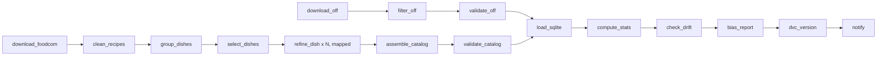

# Pantry Path data pipeline

The data side of Pantry Path. A user names a dish, a ZIP code, allergies and a diet. The pipeline answers with `result.json`: the dish's ingredients, the nearest grocery stores, and for each ingredient the store products that are **safe**, **unsafe** or **unknown** for that user, each with a reason.

It has two parts that share one codebase:

- **`build_reference_data`** (weekly Airflow DAG) builds the reference data:
  - a **dish catalog**: 100 dishes with ingredients, from Food.com recipes refined by an LLM
  - an **allergen snapshot**: ~412k US products with ingredients and allergens, from Open Food Facts

  It also validates both, computes statistics, checks drift and outliers, writes a bias report, versions the outputs with DVC and sends alerts.
- **The request flow** (terminal command, Python function, or the `serve_request` DAG) turns one request into `result.json` in a few seconds, using live Kroger data.

**Docs:**
- **Teammates who only consume the output:** [`docs/data-pipeline-handoff.md`](../docs/data-pipeline-handoff.md)
- **Results and findings:** [`docs/data-pipeline-report.md`](../docs/data-pipeline-report.md) (also as a PDF)
- **The design and its reasons:** [`docs/superpowers/specs/2026-10-24-data-pipeline-design.md`](../docs/superpowers/specs/2026-10-24-data-pipeline-design.md)
- **Where each grading criterion is met:** [section 11](#11-how-this-meets-the-assignment)

**Quick start:**
```bash
cd data-pipeline && docker compose up -d --build   # Airflow at http://localhost:8080 (airflow / airflow)
dvc pull                                           # (repo root) the latest processed data, no login needed
```



---

## 1. Setup

**You need:**
- Docker Desktop (4 GB+ of memory for Docker; the Open Food Facts filter uses up to ~2 GB)
- git
- ~10 GB of free disk for the Open Food Facts download, which is deleted after filtering
- Python 3.12 with [uv](https://docs.astral.sh/uv/), only for running without Docker

```bash
git clone <repo-url> && cd Pantry-Path
cp .env.example .env          # then fill in what you have (see below)
```

**`.env` (repo root, never committed):**

| Variable | Needed for | Without it |
|---|---|---|
| `LLM_API_KEY` (+ optional `LLM_PROVIDER`, `LLM_MODEL`) | Refining dishes with an LLM (any provider: Anthropic, Gemini or OpenAI; the key's format picks one) | Cached LLM replies are replayed (identical catalog, no cost) |
| `KROGER_CLIENT_ID`, `KROGER_CLIENT_SECRET` | The request flow (live stores and products) | The batch pipeline still runs; requests can't |
| `REDCIRCLE_API_KEY` | Optional Target fallback in the request flow | Kroger only |
| `ALERT_EMAIL_TO`, `ALERT_SMTP_USER`, `ALERT_SMTP_PASSWORD` | Email alerts (Gmail: use an app password) | Alerts are logged only |

## 2. Run the pipeline

### Option A: Airflow in Docker (the way it's meant to run)

```bash
cd data-pipeline
docker compose up -d --build      # first build takes a few minutes
open http://localhost:8080        # login: airflow / airflow
```

1. In the Airflow UI, unpause **`build_reference_data`** and trigger it. It also runs weekly.
2. **`build_reference_data_serial`** is the same pipeline with no parallelism (manual only). It exists to compare Gantt charts.
3. **`serve_request`** runs one request. Trigger it with params `dish`, `zip`, `avoid`, `diet`; the output goes to `data-pipeline/results/`.

Stop with `docker compose down` (add `-v` to also delete Airflow's database). The repo is mounted into the containers, so data, reports and logs appear on your machine as they're written.

### Option B: without Airflow

```bash
cd data-pipeline
uv venv .venv --python 3.12
uv pip install --python .venv/bin/python -r requirements.txt -e ../shared -e .
scripts/run_all.sh                  # every step, in DAG order; stops at the first failure
scripts/run_all.sh assemble-catalog # resume from a step
.venv/bin/python -m pantrypath_pipeline <step>   # run one step, e.g. validate-off
```

### Option C: reproduce without keys or the 8 GB download (graders)

```bash
dvc pull                            # from the repo root: processed data + cached LLM replies
```
Then set `off.source: dvc` in `config/pipeline.yaml` and leave `LLM_API_KEY` empty. Run `scripts/run_all.sh` (or the DAG):
- The pipeline pulls the filtered snapshot instead of downloading Open Food Facts.
- It replays the cached LLM replies, so the catalog comes out identical and no LLM calls are made.
- `dvc-version` versions the outputs locally and skips the upload with a warning, because a clone without the service account key is read-only.

This was checked on a fresh copy of the repo: tests pass, `dvc pull` works anonymously, and the rebuilt catalog matches the original.

### The request flow

```bash
.venv/bin/python -m pantrypath_pipeline.request "quiche" --zip 45202 --avoid milk gluten --diet vegetarian
```
This writes `results/<UTC time>_<dish>.json` (temporary by design; it expires after 24 h) and prints a summary. From Python, use `pantrypath_pipeline.request.build_result(cfg, query, zip_code, avoid, diet)`.

Measured on 2026-10-25:

| Request | Result | Time | Calls |
|---|---|---|---|
| "quiche", 45202, avoid milk + gluten, vegetarian | quiche lorraine: 3 Kroger stores, 12 ingredients, 180 products (39 safe, 114 unsafe, 27 unknown) | 5.3 s | 38 Kroger |
| "pad thai", 45202, avoid peanuts + shellfish (via the `serve_request` DAG) | 3 Kroger stores + 1 Target (fallback), 18 ingredients, 16 with a safe product (none for peanuts and shrimp, as expected) | 20.2 s | 56 Kroger + 4 Target |

## 3. Steps

Every step is a CLI command (`python -m pantrypath_pipeline <step>`). The Airflow tasks, `scripts/run_all.sh` and you all run the same code. Each prints a JSON summary as its last line, which Airflow keeps as the task's XCom.

| Step | Module | Reads | Writes |
|---|---|---|---|
| `download-off` | `acquire/off.py` | Hugging Face `openfoodfacts/product-database` | `data/raw/off/food.parquet` (8 GB) |
| `filter-off` | `preprocess/off_filter.py` | raw dump | `data/processed/off_products.parquet` (US products with evidence, GTIN-13 barcodes, cleaned text); deletes the raw dump |
| `validate-off` | `validate/expectations.py` | snapshot | `reports/ge/off_*.json` |
| `download-foodcom` | `acquire/foodcom.py` | Kaggle `irkaal/foodcom-recipes-and-reviews` | `data/raw/foodcom/recipes.parquet` |
| `clean-recipes` | `preprocess/recipes.py` | raw recipes | `data/interim/recipes_clean.parquet` |
| `group-dishes` | `preprocess/dishes.py` | clean recipes | `data/interim/dish_candidates.parquet` |
| `select-dishes` | `preprocess/dishes.py` | candidates | `data/interim/dish_pool.json` (popular dishes per cuisine + golden-set dishes) |
| `refine-dish` / `refine-all` | `refine.py`, `llm.py` | pool, `prompts/refine_dish.txt` | `data/interim/refined/<dish>.json`, `data/processed/llm_cache/` |
| `assemble-catalog` | `catalog_build.py` | refined dishes | `data/processed/dish_profiles.json`, `reports/catalog_summary.json` |
| `validate-catalog` | `validate/expectations.py` | catalog | `reports/ge/catalog_*.json` |
| `load-sqlite` | `store.py` | catalog | `data/processed/pantrypath.sqlite` |
| `compute-stats` | `validate/stats.py` | snapshot + catalog | `reports/stats.json`, `reports/outliers.json` |
| `check-drift` | `validate/drift.py` | this run's vs the previous run's stats | `reports/drift.json` |
| `bias-report` | `bias.py` | snapshot + catalog | `reports/bias_report.md`, `reports/bias_report.json` |
| `dvc-version` | `versioning.py` | processed outputs | `.dvc` pointer files; pushes to the remote |
| `notify` | `notify.py` | reports | a run summary (log + email) |

## 4. Code structure

```
shared/                         installable package used by the pipeline AND the backend
  pantrypath_core/
    catalog.py                  dish catalog models (DishProfile, Cuisine, Role)
    diet_rules.py               allergen + diet verdicts (safe / unsafe / unknown)
    barcodes.py                 GTIN-13 normalization (Kroger UPC -> GTIN-13)
    result.py                   result.json v1.0 models
    schema.py                   recipe model with quantities (golden set)
  tests/
data-pipeline/
  dags/                         build_reference_data (+ _serial), serve_request
  config/pipeline.yaml          every setting: paths, quotas, thresholds, models, providers
  prompts/refine_dish.txt       the fixed LLM prompt (versioned)
  scripts/run_all.sh            whole batch without Airflow
  src/pantrypath_pipeline/
    cli.py                      step runner (one command per step)
    config.py errors.py logging_setup.py alerts.py notify.py
    acquire/                    downloads with retries + integrity checks
    preprocess/                 cleaning, grouping, filtering
    llm.py refine.py catalog_build.py store.py
    validate/                   Great Expectations suites, stats + outliers, drift
    bias.py                     data slicing with Fairlearn
    providers/                  store plug-ins: Kroger, Target (RedCircle)
    off_lookup.py request.py    the request flow
    versioning.py               dvc add + push
    gantt.py                    Gantt charts + timing summary from Airflow's REST API
  tests/                        pytest, one file per module
  data/{raw,interim,processed}  raw + interim are local only; processed is tracked by DVC
  reports/                      quality, drift, bias, LLM usage, Gantt charts (in git)
  logs/                         pipeline.log + Airflow task logs (not in git)
  results/                      request outputs (temporary, not in git)
  Dockerfile docker-compose.yaml dvc.yaml requirements.in requirements.txt pyproject.toml
```

## 5. Data versioning (DVC) and reproducibility

- **Tracked by DVC:** `off_products.parquet`, `dish_profiles.json`, `pantrypath.sqlite`, `llm_cache/`. The `dvc_version` task runs `dvc add` + `dvc push`; Git holds the small `.dvc` pointer files. The DAG never commits: review and commit the pointers yourself, so every data version sits next to the code that produced it.
- **Not versioned:** the raw downloads (re-downloadable; Food.com's license is unverified, so it isn't redistributed) and `data/interim/` (rebuilt from raw).
- **Remotes** (in `.dvc/config`), both pointing at the same bucket `gs://pantry-path-dvc` (GCP project `pantry-path`, us-east1):
  - `pantrypath-public`, `https://storage.googleapis.com/pantry-path-dvc/dvcstore`: the default. Anyone can `dvc pull` over plain HTTPS with no Google login. A `gs://` pull without credentials stalls, which is why this remote exists.
  - `pantrypath-gcs`, `gs://pantry-path-dvc/dvcstore`: for pushing. Only the service account `pantrypath-dvc@pantry-path.iam.gserviceaccount.com` can write. The owner's machine points DVC at its key (kept outside the repo) and makes this remote the local default:
    ```bash
    dvc remote modify --local pantrypath-gcs credentialpath ~/.config/gcp-keys/pantrypath-dvc.json
    dvc remote default --local pantrypath-gcs
    ```
    The key folder is mounted into the Airflow containers at the same path, so the DAG's `dvc_version` step pushes with the same settings. Clones without the key skip the push with a warning. A $5 budget alert guards the bucket's cost (expected ~$0).
- **Comparing versions:** `dvc metrics show` and `dvc metrics diff HEAD~1` compare `reports/stats.json` between commits (row counts, null rates, cuisine counts...).
- **Pinned environment:** `requirements.txt` is generated from `requirements.in` with exact versions for every platform (`uv pip compile requirements.in --universal --python-version 3.12 -o requirements.txt`). The Docker image is pinned to Airflow 3.3.2 / Python 3.12.
- **Deterministic LLM step:** every LLM reply is cached under `data/processed/llm_cache/`, keyed by a hash of the prompt and schema (not the provider), and versioned. A rerun, or anyone without a key, replays it and gets the identical catalog. Temperature can't provide this: current Claude models don't accept a temperature setting.

## 6. Data quality, anomalies and alerts

- **Schema and quality checks (Great Expectations 1.x):** `validate/expectations.py` runs suites on both outputs. Examples: barcode present, unique and 13 digits; every product has ingredients or allergen tags; row count in the expected range; dish count and cuisine quotas; at least 3 ingredients and 1 core per dish; categories from the allowed list; shares between 0 and 1. Each check is tagged critical (fails the run) or warning (alert only). Results: `reports/ge/`.
- **Statistics:** `reports/stats.json`, numbers only so `dvc metrics diff` can compare runs: row counts, null and evidence rates, allergen coverage, popularity tiers, cuisine counts, ingredients per dish, LLM-added share.
- **Outliers:** ingredients per dish, recipes per dish and ingredient-statement length are checked with an IQR rule (on a log scale for the skewed ones). Offenders go to `reports/outliers.json` with a warning alert.
- **Drift:** `reports/drift.json` compares each run with the previous one. A row-count change over 10% or a rate shift over 5 points is a warning; a row-count change over 30% fails the run.
- **Alerts:** always logged; also emailed when the alert variables are set in `.env`. A failed task alerts through the DAG's failure callback.

## 7. Bias detection and mitigation

See [`reports/bias_report.md`](reports/bias_report.md), generated from the real data by `bias.py` with Fairlearn's `MetricFrame`.

- **Catalog:** a plain top 100 Food.com dishes would be almost all American or untagged. Cuisine quotas (60 / 10 / 10 / 10 / 5 / 5) fix the mix.
- **Diet rules** (the classifier we evaluate, since no model is trained in this assignment): we slice products by category, store vs national brand, and popularity. For each slice we compare the unknown rate and the accuracy against Open Food Facts' own vegan / vegetarian / gluten-free labels, which are used for evaluation only. The mitigation is reading the ingredient text when tags are missing; the report shows before vs after and the trade-offs.

## 8. Pipeline optimization (Gantt)

`build_reference_data_serial` runs everything one task at a time; `build_reference_data` runs the two branches in parallel and refines 4 dishes at once. Airflow's Gantt view (Grid → a run → Gantt) shows each run. To save both charts and a comparison, run `python -m pantrypath_pipeline.gantt build_reference_data_serial build_reference_data`, which reads the timings from Airflow's REST API and writes `reports/gantt_<dag>.svg` and `reports/gantt_summary.md`. Results:

| Run (2026-10-25, same data, LLM replies from cache) | Wall time | Sum of task times | Bottleneck |
|---|---|---|---|
| `build_reference_data_serial` (before) | **11.2 min** | 9.2 min | 254 `refine_dish` tasks one at a time (6.5 min), then the 8 GB download (2.0 min) |
| `build_reference_data` (after) | **4.6 min (−59%)** | 11.0 min | The two branches now overlap: download + filter (2.5 min) alongside Food.com + refine (2.8 min, 4 dishes at a time); then the bias report (1.5 min) |


What the charts show:
- **Branch parallelism:** the Open Food Facts branch (blue) and the Food.com → LLM branch (green, orange) run side by side, so the 2-minute download no longer delays the catalog.
- **Mapped LLM tasks:** `refine_dish` runs one Airflow task per dish, 4 at a time (`llm.concurrency`).
  - In these runs every reply came from the cache, so each task takes seconds.
  - On a first run with live LLM calls, the same 253 calls took 5.3 min at 4 at a time. One at a time, that would be roughly 20 min, so the parallelism matters even more then.
- **Trade-off:** the total task time rises (9.2 → 11.0 min) because tasks running side by side share the CPU, but the wall time drops by more than half.
- **Next bottleneck:** `bias_report` (1.5 min) at the end of the chain. It could run alongside `dvc_version`, or on a smaller sample.

## 9. Error handling and logging

- **Retries:** every Airflow task retries twice with exponential backoff. API calls retry inside the step on rate limits, server errors and timeouts.
- **File integrity:** a corrupt or truncated download is detected (Parquet footer, required columns, size or row count), deleted and downloaded once more before the step fails.
- **Unavailable sources:** if a source stays unreachable but a previous processed output exists, the step falls back to it and alerts.
- **LLM failures:** one dish's bad reply is retried once, then recorded and skipped. The run fails only if fewer than 90 dishes survive.
- **Messages that say what to do:** pipeline errors (`errors.py`) name the step and what to check, e.g. "run the group-dishes step first".
- **Logs:**
  - `logs/pipeline.log` (rotating; every step's start, end, timing and summary)
  - `logs/airflow/` (Airflow's per-task logs)
  - stderr (shown in the Airflow UI)

## 10. Tests and code style

```bash
cd data-pipeline
.venv/bin/python -m pytest -q tests ../shared/tests     # unit tests, no network
RUN_LIVE_TESTS=1 .venv/bin/python -m pytest -q -m live  # optional: real APIs (free ones)
.venv/bin/ruff check src tests dags ../shared            # PEP 8 + import order + bugbear
docker compose exec airflow-scheduler bash -c \
  "cd /opt/pantrypath/data-pipeline && PYTHONPATH=src:../shared python -m pytest -q tests/test_dags.py"
```
Tests cover every step: edge cases such as missing values, HTML entities, Unicode fractions, bad barcodes, duplicate ids, truncated downloads, outliers, drift thresholds, LLM replies that fail to parse, and synthetic store responses. Kroger responses are never saved, not even as test fixtures.

**CI:** `.github/workflows/data-pipeline.yml` runs ruff and the unit tests on every push to `main` or a `feature/**` branch, and on every pull request to `main`, that touches the pipeline. It needs no keys and no data downloads.

## 11. How this meets the assignment

| # | Criterion | Where to look | Evidence |
|---|---|---|---|
| 1 | Documentation | This README; [`docs/data-pipeline-report.md`](../docs/data-pipeline-report.md) (+ PDF); [`docs/data-pipeline-handoff.md`](../docs/data-pipeline-handoff.md); design spec; docstrings in every module | Setup, run, structure, DVC and reproducibility covered above |
| 2 | Modular, reusable code | `src/pantrypath_pipeline/`: one module per step behind one CLI (`cli.py`); `shared/pantrypath_core` reused by the backend; every setting in `config/pipeline.yaml` | Each step runs alone: `python -m pantrypath_pipeline <step>` |
| 3 | Airflow orchestration | `dags/build_reference_data.py` (weekly, two parallel branches, dynamic task mapping, retries with backoff, timeouts, failure alerts); `dags/serve_request.py` | Full runs green on 2026-10-25 (270/270 tasks) |
| 4 | Tracking and logging | `logs/pipeline.log`, Airflow task logs, a JSON summary per step (XCom), the `notify` step | Section 9 |
| 5 | DVC | `.dvc/config` (public bucket `gs://pantry-path-dvc`), `data/processed/*.dvc`, `dvc.yaml` metrics, the `dvc_version` step | `dvc pull` works anonymously; `dvc metrics diff` compares runs |
| 6 | Flow optimization (Gantt) | `reports/gantt_*.svg`, `reports/gantt_summary.md` | 11.2 → 4.6 min (−59%), section 8 |
| 7 | Schema and statistics | `validate/expectations.py` (Great Expectations suites), `reports/ge/`, `validate/stats.py` → `reports/stats.json` | OFF: 12 checks; catalog: 20 checks |
| 8 | Anomalies and alerts | Critical/warning checks, `reports/outliers.json`, `reports/drift.json`, `alerts.py` (log + email) | 95 outliers flagged as warnings; drift OK |
| 9 | Bias (data slicing) | `bias.py` (Fairlearn `MetricFrame`), [`reports/bias_report.md`](reports/bias_report.md) | Cuisine quotas; unknown rate 77% → 1.0% with ingredient-text fallback; limits stated |
| 10 | Tests | `tests/` + `shared/tests/` (24 files, 676 tests), CI workflow | Missing values, edge cases, anomalies, synthetic API responses |
| 11 | Reproducibility | Pinned `requirements.txt`, Docker image, DVC remote, LLM reply cache, option C above | Fresh copy rebuilt the identical catalog with no keys |
| 12 | Error handling | `errors.py`, retries (tenacity + Airflow), download integrity checks, fallback to the last snapshot, per-dish LLM failure isolation | Messages say what to check next |

The assignment's example layout (`Data-Pipeline/` with `dags/`, `data/`, `scripts/`, `tests/`, `logs/`, `dvc.yaml`, `README.md`) maps one-to-one onto `data-pipeline/`. Data acquisition lives in `acquire/` (dependencies in `requirements.txt`), and preprocessing in `preprocess/`, `refine.py` and `catalog_build.py`.

## 12. Data sources and terms

| Source | Use | Terms we follow |
|---|---|---|
| [Open Food Facts](https://world.openfoodfacts.org) | Allergen snapshot | Open Database License: attribute "Open Food Facts"; derived data stays ODbL |
| [Food.com recipes (Kaggle)](https://www.kaggle.com/datasets/irkaal/foodcom-recipes-and-reviews) | Dish catalog source | License unverified: raw data is not redistributed |
| [Kroger API](https://developer.kroger.com) | Live stores and products | No storing or caching beyond the cache header (none is sent): in-memory only |
| RedCircle (Target) | Experimental fallback | Storage terms unverified: nothing stored |
| LLM (Anthropic for this run) | Dish refinement | Output tagged `source: llm` / `added_by_llm`; not used for fine-tuning |
