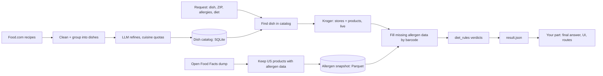

# Pantry Path data pipeline: what the team gets

**Updated:** 2026-10-25 · **Status:** built, tested and running. Branch `feature/data-pipeline`; numbers below come from the runs on 2026-10-24/25.
**Related:**
- results and findings: `docs/data-pipeline-report.md` (+ `.pdf`)
- setup and commands: `data-pipeline/README.md`
- design and its reasons: `docs/superpowers/specs/2026-10-24-data-pipeline-design.md`
- contract schema: `docs/result-v1.schema.json`

---

## 1. In one minute

- **Input:** a dish name, a US ZIP code, allergens to avoid, a diet (vegan / vegetarian / none).
- **Output:** `result.json`, which lists the dish's ingredients, the nearest grocery stores, and for every ingredient up to 5 products per store, each with a verdict: **safe**, **unsafe** or **unknown**, plus a reason.
- **Where the output goes:** your part takes `result.json` and turns it into the final answer, UI or route. The pipeline never writes the final answer, never substitutes ingredients and never shows prices.
- **How you call it:** one Python function (`build_result`), a terminal command, or an Airflow DAG for demos.
- **What runs in the background:** a weekly Airflow pipeline refreshes two data files the request flow reads: a **dish catalog** (100 dishes) and an **allergen snapshot** (~410k US products from Open Food Facts). Both are versioned with DVC.
- **The one rule that matters most:** *unknown is never safe.* If we can't see a product's ingredient list, it is not shown as safe.

## 2. The big picture



The top two rows run **weekly** (Airflow DAG `build_reference_data`). The bottom row runs **per request**, in a few seconds.

## 3. Data products

| File (under `data-pipeline/data/processed/`) | What it is | Size | Refresh | How to get it |
|---|---|---|---|---|
| `pantrypath.sqlite` | Dish catalog for fast lookup (dishes, aliases, ingredients) | < 1 MB | Weekly | `dvc pull` |
| `dish_profiles.json` | The same catalog as JSON (`pantrypath_core.catalog.Catalog`) | < 1 MB | Weekly | `dvc pull` |
| `off_products.parquet` | US products with ingredients or allergen data, keyed by GTIN-13 barcode; English ingredient text only, cleaned of HTML | ~32 MB, ~410k rows | Weekly | `dvc pull` |
| `llm_cache/` | Every LLM reply used to build the catalog (one file per prompt) | A few MB | Weekly | `dvc pull` |

Not data products, but useful:

| Where | What |
|---|---|
| `data-pipeline/reports/` | `stats.json` (data statistics), `drift.json`, `outliers.json`, `ge/` (Great Expectations results), `bias_report.md`, `catalog_eval.md`, `catalog_summary.json`, `llm_usage.json`, Gantt screenshots. All in Git. |
| `data-pipeline/results/` | Request outputs from the terminal command. Temporary by design, gitignored. |
| `data/golden/recipes.json` | 16 hand-written recipes (with quantities) for evals: the dev split, used while building the pipeline. |
| `data/golden/recipes_heldout.json` | 27 more recipes for other catalog dishes: the held-out test split, written after the catalog was frozen. Use it to evaluate, never to tune prompts or rules. Scores: `data-pipeline/reports/catalog_eval.md`. |
| `data-pipeline/data/eval/diet_rules_seen_barcodes.parquet` | Barcodes diet_rules was tuned on. Products outside it are the diet-rules held-out set (`bias_report.md`). |

**Never stored anywhere:** Kroger data. Kroger's API terms forbid keeping copies, so it lives in memory during a request only (15-minute cache).

**Getting the data:** run the Airflow DAG `build_reference_data` (`data-pipeline/README.md` section 1), which builds everything and fetches the saved LLM replies itself. Or, in a Python environment with `data-pipeline/requirements.txt` installed (it includes DVC), run `dvc pull` from the repo root. DVC pulls from the public-read bucket `gs://pantry-path-dvc` (GCP project `pantry-path`) over plain HTTPS, so no Google login is needed; it takes a few seconds. Only the pipeline's service account can push.

## 4. The request flow

**Inputs**

| Input | Rules |
|---|---|
| `query` | Free text dish name, e.g. "quiche", "chicken tikka masala" |
| `zip` | 5-digit US ZIP |
| `avoid` | Any of: `milk`, `egg`, `fish`, `shellfish`, `tree_nuts`, `peanuts`, `wheat`, `soy`, `sesame`, `gluten` |
| `diet` | `vegan`, `vegetarian` or `none` |

**What happens**
1. **Find the dish:** exact name or alias in the catalog, then a fuzzy match (score ≥ 90). If the dish isn't in the catalog, the LLM builds a profile on the fly (`dish.source = "llm"`).
2. **Find stores:** nearest 3 Kroger-family stores within 10 miles. Target is the fallback when there's no Kroger nearby or no in-stock product.
3. **Find products:** every core and common ingredient at every store, top 5 products, searched in parallel.
4. **Gather evidence:** Kroger's own allergen and ingredient data first. If it's missing, the Open Food Facts snapshot by barcode. If both are missing, the product is unknown.
5. **Verdicts:** `diet_rules` gives every product a verdict and a reason.
6. **Write `result.json`:** with a summary of ingredients that have no safe product, and an `expires_at` 24 hours later.

**Performance and limits**
- About 38 Kroger calls per request (3 stores × ~12 ingredients + a store search + a token). Measured:
  - quiche lorraine (12 ingredients) took **5.3 s and 38 calls**
  - pad thai (18 ingredients, with the Target fallback kicking in) took **20.2 s, 56 Kroger calls + 4 Target credits**

  Bigger dishes and fallbacks cost time.
- Kroger's daily limit is reportedly 10,000 calls (not yet verified). At ~38 calls per request, that's **roughly 260 requests per day**. Repeated requests within 15 minutes are served from memory.

## 5. `result.json` contract v1.0

The JSON Schema is in **`docs/result-v1.schema.json`** (generate types from it, e.g. for TypeScript). The Python model is `pantrypath_core.result.Result`. Import it rather than redefining it. A test fails if the schema file and the model ever disagree; regenerate it with `python shared/tests/test_contract_schema.py`.

```json
{
  "request": {"query": "quiche", "zip": "45202", "avoid": ["milk", "gluten"], "diet": "vegetarian"},
  "dish": {"name": "quiche lorraine", "cuisine": "european", "source": "catalog"},
  "stores": [
    {"store_id": "01400943", "chain": "KROGER", "name": "Kroger Over-the-Rhine",
     "address": "1420 Vine St, Cincinnati, OH 45202", "lat": 39.11, "lon": -84.51, "distance_miles": 0.8}
  ],
  "ingredients": [
    {"name": "eggs", "role": "core", "category": "egg", "products": [
      {"store_id": "01400943", "barcode": "0011110838629", "name": "Kroger Grade A Large Eggs",
       "brand": "Kroger", "size": "12 ct", "in_stock": true, "aisle": "Dairy",
       "verdict": "safe", "reason": "No milk or gluten; vegetarian", "evidence_source": "kroger"}
    ]},
    {"name": "heavy cream", "role": "core", "category": "dairy", "products": [
      {"store_id": "01400943", "barcode": "0011110903211", "name": "Kroger Heavy Whipping Cream",
       "brand": "Kroger", "size": "16 fl oz", "in_stock": true, "aisle": null,
       "verdict": "unsafe", "reason": "Contains milk", "evidence_source": "kroger"}
    ]}
  ],
  "summary": {"ingredients_total": 2, "with_safe_product": 1, "without_safe_product": ["heavy cream"]},
  "meta": {"generated_at": "2026-10-24T22:10:00Z", "expires_at": "2026-10-25T22:10:00Z",
           "providers_used": ["kroger"], "catalog_version": "2026-10-24", "schema_version": "1.0"}
}
```
*(Illustrative values; the shape is exact.)*

| Field | Meaning |
|---|---|
| `dish.source` | `catalog` = from the weekly catalog; `llm` = built on the fly because the dish wasn't in the catalog |
| `dish.cuisine` | `american`, `european`, `latin_american`, `east_se_asian`, `south_asian`, `middle_eastern_african` |
| `ingredients[].role` | `core` = the dish isn't itself without it; `common` = in many versions, not all |
| `ingredients[].category` | `produce`, `dairy`, `egg`, `meat`, `seafood`, `grain`, `bakery`, `legume`, `nut_seed`, `oil_fat`, `spice_herb`, `condiment`, `sweetener`, `baking`, `beverage`, `other` |
| `products[].barcode` | GTIN-13 (13 digits). May be `null` when a store doesn't give barcodes |
| `products[].in_stock` | `true` / `false`, or `null` when the store doesn't report stock |
| `products[].verdict` | `safe` / `unsafe` / `unknown` for **this** user's avoid list and diet |
| `products[].reason` | Short human-readable reason, e.g. "Contains milk", "May contain tree nuts (cross-contact)", "No ingredient list to check for gluten" |
| `products[].evidence_source` | Where the allergen data came from: `kroger`, `target`, `off` (Open Food Facts) or `none` |
| `summary.without_safe_product` | Ingredients with no safe product at any store. This is where your final answer suggests substitutes |
| `meta.expires_at` | Don't use the file after this time (Kroger's terms; prices and stock change) |
| `meta.schema_version` | `"1.0"`; bumped on any breaking change |

**Guarantees** (checked by the model, so a broken file can't be produced):
- Every product's `store_id` is one of `stores`.
- `summary` always matches `ingredients`.
- `expires_at` is after `generated_at`.
- A product is `safe` only when we saw its full ingredient list and nothing conflicts.

## 6. Using it from the backend

**Setup** (Python 3.12):
```bash
pip install -r data-pipeline/requirements.txt -e shared -e data-pipeline
dvc pull                       # catalog + allergen snapshot
```
Environment (repo-root `.env`; names in `.env.example`):

| Variable | Needed for |
|---|---|
| `KROGER_CLIENT_ID`, `KROGER_CLIENT_SECRET` | Every request (stores + products) |
| `LLM_API_KEY` (+ optional `LLM_PROVIDER`, `LLM_MODEL`) | Only for dishes not in the catalog. Any provider: Anthropic, Gemini or OpenAI. Without it, unknown dishes return an error instead |
| `REDCIRCLE_API_KEY` | Optional Target fallback |
| `PANTRYPATH_HOME` | Optional: where `data-pipeline/` lives, if not next to the code |

**Call it:**
```python
from pantrypath_core.diet_rules import Allergen, Diet
from pantrypath_pipeline.config import load_config
from pantrypath_pipeline.request import build_result

cfg = load_config()  # data-pipeline/config/pipeline.yaml + .env
result = build_result(cfg, "quiche", "45202", [Allergen.milk, Allergen.gluten], Diet.vegetarian)
payload = result.model_dump(mode="json")
```
- `build_result` is blocking (it uses threads inside). In FastAPI, declare the endpoint with `def` (not `async def`) or wrap it with `run_in_threadpool`.
- Load the config once at startup and reuse it.

**Errors** (all subclasses of `pantrypath_pipeline.errors.PipelineError`):

| Error | When | Suggested HTTP status |
|---|---|---|
| `pydantic.ValidationError` | Bad input (ZIP, allergen name, diet) | 422 |
| `ProviderError` | Kroger (and the fallback) failed or timed out | 502 / 503 |
| `DataUnavailableError` | Catalog or allergen snapshot file missing (run `dvc pull`) | 503 |
| `LLMError` / `PipelineError` | Dish not in catalog and no LLM key, or the LLM failed | 404 or 503 |

**Other ways to run it:**
- **Terminal:** `python -m pantrypath_pipeline.request "quiche" --zip 45202 --avoid milk gluten --diet vegetarian` writes `data-pipeline/results/<time>_<dish>.json`.
- **Airflow:** DAG `serve_request`, triggered with params `dish`, `zip`, `avoid`, `diet`. Good for demos. Airflow adds seconds of scheduling time, so it isn't for real users.

## 7. Shared code you can import (`shared/pantrypath_core`)

| Module | Use it for |
|---|---|
| `result` | The `result.json` models (`Result`, `Product`, `Summary`, ...) |
| `diet_rules` | `assess(evidence, avoid, diet) -> Verdict`; `ProductEvidence`; `Allergen`, `Diet`. The backend should use this, not its own allergen logic, so everyone gives the same answer |
| `catalog` | `DishProfile`, `CatalogIngredient`, `Cuisine`, `Role` |
| `schema` | `Recipe` / `Ingredient` with quantities and units (used by the golden set; useful for the final-answer model's output) |
| `barcodes` | `to_gtin13()`, `kroger_upc_to_gtin13()` |

## 8. The dish catalog

- **100 dishes** with cuisine quotas: 60 American, 10 European, 10 Latin American, 10 East/Southeast Asian, 5 South Asian, 5 Middle Eastern/African. A plain top 100 by popularity was 89% American, so the quotas are deliberate. If a cuisine can't fill its quota, the shortfall is reported, not backfilled.
- **Ingredients only, no quantities.** Food.com quantities have no units, so amounts are the final-answer step's job.
- **Built from** Food.com recipes (Kaggle), grouped into dishes, then refined by an LLM (Claude Opus 5.5 for this run). The LLM merges duplicates, drops non-dishes, unifies ingredient names, marks core vs common, adds key ingredients the source dropped (lasagna noodles appear in only 2% of Food.com lasagna recipes) and assigns cuisine.
- **Tags:** `share` = fraction of source recipes listing the ingredient; `added_by_llm = true` = added by the LLM (share 0); dish `source` = `foodcom` or `llm`.
- **SQLite tables:**
  - `dishes(dish_id, name, cuisine, recipe_count, review_count, source, catalog_version)`
  - `dish_aliases(alias, dish_id)`
  - `dish_ingredients(dish_id, position, name, role, category, share, added_by_llm)`
  - `meta(key, value)`
- Lookup helper: `pantrypath_pipeline.store.find_dish(db_path, query, min_score)`.

## 9. How verdicts are decided (`diet_rules`)

| Situation | Verdict |
|---|---|
| No allergens to avoid and diet `none` | safe ("No restrictions to check") |
| No ingredient list and no allergen data | unknown |
| Declared or listed allergen the user avoids | unsafe ("Contains milk") |
| "May contain" an avoided allergen | unsafe ("May contain ... (cross-contact)") |
| Allergen list but no ingredient list, nothing conflicting | unknown (a list alone can't prove safe) |
| Oats without a gluten-free claim, user avoids gluten | unknown (cross-contact risk) |
| Meat or fish in the ingredients, name or category, user vegetarian or vegan | unsafe (catches cure-only bacon) |
| Honey, user vegan | unsafe (fine for vegetarian) |
| Full ingredient list, nothing conflicts | safe |

Order of precedence: **unsafe beats unknown beats safe.** Evidence comes from Kroger first, then Open Food Facts by barcode.

## 10. Rules for everyone

1. **Don't store Kroger data** (no databases, no long-lived caches, no logs of product payloads). Respect `expires_at`.
2. **Unknown is never safe.** Show unknown products as "couldn't verify", or hide them.
3. **The LLM may come before `result.json`, never after it in a way that changes verdicts.** The final answer can explain and suggest substitutes but must not flip a verdict.
4. **Attribution:** product data from Open Food Facts is under the Open Database License (ODbL). Show "Product data: Open Food Facts (openfoodfacts.org)" wherever it appears, and keep derived files under ODbL.
5. **No fine-tuning on LLM-written content.** Catalog content written by the LLM is tagged (`added_by_llm`, `source: llm`); use it for prototyping and evaluation only until we've checked the provider's terms.
6. **Need a contract change?** Open an issue or PR. `schema_version` lets it evolve without breaking you.

## 11. Operations

- **Weekly DAG `build_reference_data`** (Airflow 3.3 in Docker; UI at http://localhost:8080). Two branches run in parallel (Open Food Facts; Food.com → LLM → catalog), then load, stats, drift check, bias report, DVC versioning and a success notification.
- **Quality checks:** Great Expectations suites on both outputs, outlier checks, drift against the previous run. Blocking problems fail the run; warnings send an alert.
- **Alerts:** always logged and emailed to the project address in `config/pipeline.yaml` (`alerts.email_to`); tested on 2026-10-26. To get them yourself, set `ALERT_SMTP_USER` (your Gmail), `ALERT_SMTP_PASSWORD` (its app password) and `ALERT_EMAIL_TO` in `.env`.
- **Reruns are reproducible and free:**
  - The catalog's LLM step ran once (Claude Opus 5.5, $6.08).
  - The DAG pulls those saved replies (`pull_llm_cache`) and replays them, so nobody needs an LLM key or pays again. Weekly runs only refresh the Open Food Facts snapshot.
  - `off.source: dvc` skips the 8 GB download.
- **Adding a store provider:** one class in `data-pipeline/src/pantrypath_pipeline/providers/` + one line in `config/pipeline.yaml`.
- **Adding an allergen or diet:** extend the enums and rules in `diet_rules.py` + tests; `schema_version` bump if the contract changes.

## 12. Numbers from today's run (2026-10-24)

| Check | Value |
|---|---|
| Allergen snapshot | 410,009 US products (English ingredient lists only), 30 MB (from the 8 GB dump in ~11 s); ingredient text on 99.97%, allergen tags on 61% |
| Dish catalog | 100 dishes: 60 American, 10 European, 10 Latin American, 10 East/SE Asian, 5 South Asian, 5 Middle Eastern/African (quotas met); 508 aliases; 1,171 ingredient rows; all 16 golden-set dishes included |
| Catalog build | 254 candidate dishes → 215 kept, 31 merged, 8 dropped as non-dishes, 0 failures; quality suites: 20 checks, 0 failures |
| Example request | "quiche", 45202, avoid milk + gluten, vegetarian → quiche lorraine, 3 Kroger stores (0.6–1.3 mi), 12 ingredients, 180 products (39 safe, 114 unsafe, 27 unknown), 4 of 12 ingredients with a safe product; **5.3 s, 38 Kroger calls** |
| Example via Airflow (`serve_request`) | "pad thai", 45202, avoid peanuts + shellfish → 3 Kroger stores + 1 Target (fallback), 18 ingredients, 16 with a safe product (none for peanuts and shrimp, as expected); 20.2 s |
| Evidence coverage (smoke run, 120 products) | Kroger's own data 99, Open Food Facts by barcode 9, none 12 |
| Batch DAG time: serial vs parallel (Gantt) | 11.2 min → **4.6 min** (−59%) for the whole weekly pipeline, LLM replies from cache; charts in `data-pipeline/reports/gantt_*.svg` |
| Bias report headline | Reading ingredient text cut diet_rules' unknown rate from 77% to 0.6% (false-safe 0.0% → 0.4%); widest gap left: bakery and cereals 2.9% vs pantry condiments 0.1% unknown. Full report: `data-pipeline/reports/bias_report.md` |
| LLM cost of the catalog build | $6.08 (Claude Opus 5.5, 254 calls); reruns replay the cache for $0 |

## 13. Known limits and open items

- **Kroger only (plus an experimental Target fallback).** Other chains per state come later. Target runs on RedCircle's free plan: about 94 of 100 credits are left, and each request that falls back spends a few (capped at 30). Target search results have no barcodes, so those products rely on the ingredient list from the product page.
- **Unverified so far:** Kroger's daily limit, RedCircle's storage terms and barcodes, and the Food.com dataset license (so raw Food.com data is not redistributed).
- **Open Food Facts coverage:** good for Kroger products in our sample (99% of barcodes found), but labels are self-reported and some products lack ingredient lists, which makes those products unknown.
- **No quantities, prices, nutrition, or medical/religious diets** in this version.
- **The catalog is 100 dishes.** Anything else goes through the on-the-fly LLM path, which needs an LLM key and is slower (one extra call).
