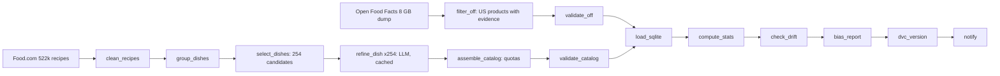
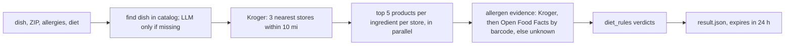

# Pantry Path: Data Pipeline Report

**Team 11** · MLOps data pipeline assignment · 2026-10-25 · owner: Ansh
Replaces the 2026-10-19 design draft. PDF version: [`data-pipeline-report.pdf`](data-pipeline-report.pdf).

---

## What this is

This is the data side of Pantry Path. It covers everything from a user typing a dish to a JSON file, `result.json`, that lists:
- the dish's ingredients
- the nearest grocery stores
- which store products are **safe**, **unsafe** or **unknown** for the user's allergies and diet

What happens after that file belongs to other teammates: the final LLM answer, the UI and routes. No model is trained here.

**Rule of thumb:** the LLM can be used anywhere *before* `result.json`, never after it.

## Summary

- **Weekly pipeline (Airflow 3.3):**
  - builds a **100-dish catalog**: Food.com recipes refined by an LLM, with cuisine quotas
  - builds an **allergen snapshot** of **411,910 US products** from Open Food Facts
  - validates both, profiles them, checks drift, writes a bias report and versions everything with DVC
- **Request flow:** answers "dish + ZIP + allergies + diet" with `result.json` in about 5 seconds, using live Kroger data. It runs from Python, the terminal or Airflow.
- **Shared code:** the `pantrypath_core` package holds the diet rules, the `result.json` v1.0 contract (with a JSON Schema) and the catalog models. The backend uses the same code.
- **Quality:** Great Expectations suites with 32 checks (0 critical failures), statistics, drift and outlier checks, and alerts.
- **Bias:** cuisine quotas fix the catalog mix. Reading ingredient text cuts the diet rules' "unknown" rate from 77% to 1.0%.
- **Speed:** parallel branches plus 4 LLM tasks at a time cut the weekly run from **11.2 to 4.6 minutes (−59%)**.
- **Tests:** 676 pytest tests that never touch the network, all passing (plus 9 live-API tests that are off by default), and a CI workflow that runs them on every push.

## Architecture

**Weekly batch, Airflow DAG `build_reference_data`.** Two branches run in parallel:
- **Open Food Facts branch:**
  - download the daily 8 GB Parquet file from Hugging Face
  - filter it with DuckDB to US products that have ingredients or allergen tags, normalize barcodes to GTIN-13, clean the text
  - validate the result
- **Food.com branch:**
  - download 522k recipes from Kaggle
  - clean and group them into dishes, and pick 254 candidates (popular dishes per cuisine plus the 16 golden-set dishes)
  - refine each candidate with one mapped LLM task (4 at a time, replies cached)
  - assemble the 100-dish catalog with cuisine quotas, and validate it

The branches then join: load SQLite → statistics → drift check → bias report → DVC versioning → notify.

**Per request.** Python `build_result()`, the terminal command, or the `serve_request` DAG for demos:

## Data products and where they live

| File (`data-pipeline/data/processed/`) | What it is | Size |
|---|---|---|
| `off_products.parquet` | 411,910 US products with ingredients or allergen tags, keyed by GTIN-13 barcode | 30 MB |
| `dish_profiles.json` + `pantrypath.sqlite` | The 100-dish catalog, as JSON and as a lookup database (508 aliases, 1,171 ingredient rows) | < 0.5 MB |
| `llm_cache/` | 254 LLM replies keyed by prompt hash, replayed when there's no LLM key | 3.8 MB |

- **Versioning:** all of these are refreshed weekly and versioned with **DVC** in the public-read bucket **`gs://pantry-path-dvc`** (GCP project `pantry-path`, us-east1).
- **Access:** anyone can `dvc pull` without credentials. Only the pipeline's service account can push.
- **Cost:** a version is about 35 MB, which is well inside the free tier. A $5 budget alert guards the bucket.
- **Reports:** quality, drift, bias, LLM usage and Gantt charts live in `data-pipeline/reports/`, in Git.
- **Never stored: Kroger data.** Kroger's API terms forbid keeping copies, so it's held in memory during a request only, and `result.json` expires after 24 hours.

## Request flow and `result.json` v1.0

| Input | Values |
|---|---|
| `query` | Free-text dish, e.g. "quiche" |
| `zip` | 5-digit US ZIP |
| `avoid` | `milk`, `egg`, `fish`, `shellfish`, `tree_nuts`, `peanuts`, `wheat`, `soy`, `sesame`, `gluten` |
| `diet` | `vegan`, `vegetarian`, `none` |

The output has six parts:
- `request`, `dish` and `stores`
- `ingredients`: each product gets a `verdict`, a `reason` and an `evidence_source`
- `summary`: includes `without_safe_product`, the ingredients the final answer should suggest swaps for
- `meta`: includes `expires_at` and `schema_version`

**Verdict rules:**
- Unsafe beats unknown, which beats safe.
- A product is safe only when its full ingredient list was checked.
- "May contain" counts as unsafe.
- No evidence means unknown.

The JSON Schema is [`result-v1.schema.json`](result-v1.schema.json). Backend usage, errors and team rules are in [`data-pipeline-handoff.md`](data-pipeline-handoff.md).

## Results

| Check | Result |
|---|---|
| Allergen snapshot | 411,910 US products, 30 MB (filtered from the 8 GB dump in about 20 s). Ingredient text on 99.97%, allergen tags on 61% |
| Dish catalog | 100 dishes: 60 American, 10 European, 10 Latin American, 10 East/SE Asian, 5 South Asian, 5 Middle Eastern/African. Quotas met; all 16 golden-set dishes included |
| Catalog build | 254 candidates → 215 kept, 31 merged, 8 dropped as non-dishes, 0 failed |
| Example request | "quiche", 45202, avoid milk + gluten, vegetarian → quiche lorraine, 3 Kroger stores, 12 ingredients, 180 products (39 safe, 114 unsafe, 27 unknown) in **5.3 s with 38 Kroger calls** |
| LLM cost | **$6.08** for the catalog build (Claude Opus 5.5, 254 calls). Reruns replay the cache for $0 |

## Data quality and monitoring

- **Great Expectations:**
  - **Open Food Facts:** 3 suites, 12 checks. 0 critical failures and 1 warning (52 products where Open Food Facts reports a completeness above 1).
  - **Catalog:** 2 suites, 20 checks, 0 failures.
  - Critical checks fail the run; warnings only alert. Results are in `reports/ge/`.
- **Statistics:** `reports/stats.json` holds row counts, null and evidence rates, allergen coverage and cuisine counts. It is a DVC metric, so `dvc metrics diff` compares data versions.
- **Drift:** each run is compared with the previous one. A row-count change over 10% or a rate shift over 5 points is a warning; a row-count change over 30% fails the run. The latest run: OK, 0 warnings.
- **Outliers:** IQR checks (log scale for skewed values) flagged 95 items as warnings: 88 very long ingredient lists and 7 dishes with unusual ingredient counts.
- **Alerts:** always logged, and emailed through Gmail SMTP once the app password is set. A failed task alerts through the DAG's failure callback.
- **Error handling:**
  - retries with backoff
  - integrity checks on every download (a corrupt file is re-downloaded once)
  - fallback to the last snapshot when a source is down
  - one bad LLM reply never fails the run; fewer than 90 dishes does

## Bias detection and mitigation

We train no model in this phase, so two things are checked for bias: the **dish catalog** (which cuisines get dishes) and **diet_rules** (the safe / unsafe / unknown classifier). Both are sliced with Fairlearn's `MetricFrame`.

**Catalog by cuisine:**

| Cuisine | Plain top 100 (before) | Quota | Catalog (after) |
|---|---|---|---|
| American | 1 | 60 | 60 |
| European | 13 | 10 | 10 |
| Latin American | 7 | 10 | 10 |
| East/SE Asian | 4 | 10 | 10 |
| South Asian | 1 | 5 | 5 |
| Middle Eastern/African | 1 | 5 | 5 |
| No cuisine tag | 73 | – | – |

Untagged Food.com dishes were mostly American when checked by hand, so a plain top 100 is 74% American or untagged. The trade-off of quotas: the added cuisines rest on fewer source recipes (a median of 51 vs 127 for American dishes).

**diet_rules on a fixed sample of Open Food Facts products, all users.** The ground truth is Open Food Facts' vegan, vegetarian and gluten-free labels, used for evaluation only.

| Metric | Tags only (before) | Full rules (after) |
|---|---|---|
| Unknown (can't decide) | 77% | 1.0% |
| Accuracy when decided | 100% | 99% |
| False safe (the dangerous error) | 0.0% | 0.4% |
| Labelled-safe products confirmed safe | 0% | 95% |

- **Widest remaining gaps in the unknown rate:**
  - by category: plant-based substitutes 3.7% vs meals 0.3%
  - by popularity: 10+ scans 4.0% vs 0 scans 0.7%
  - by brand type: national 1.3% vs store brands 0.7%
- **Mitigations:**
  - cuisine quotas
  - reading the ingredient text, plus name and category checks (this catches cure-only bacon)
  - unknown is never shown as safe
- **Limitations, stated in the report:**
  - **Not a held-out evaluation:** the rules were adjusted after looking at mismatches with these same labels, so the accuracy numbers are likely optimistic.
  - **Label noise:** some products labelled vegan or gluten-free list eggs or wheat.
  - **Circular gluten numbers:** gluten "unsafe" comes from the same tags the rules read, so it scores near-perfect by construction.

Full report: [`data-pipeline/reports/bias_report.md`](../data-pipeline/reports/bias_report.md).

## Pipeline optimization (Gantt)

| Run (same data, LLM replies from cache) | Wall time | Sum of task times | Bottleneck |
|---|---|---|---|
| `build_reference_data_serial` (before) | **11.2 min** | 9.2 min | 254 refine tasks one at a time (6.5 min), then the 8 GB download (2.0 min) |
| `build_reference_data` (after) | **4.6 min (−59%)** | 11.0 min | The download + filter (2.5 min) now overlap Food.com + refine (2.8 min, refine 4 at a time); the bias report (1.5 min) is next |

- **Total task time rose while wall time fell.** Total task time went from 9.2 to 11.0 min because tasks running side by side share the CPU, but the wall time dropped by more than half.
- **Live LLM calls make the gain bigger.** With live calls instead of the cache, the 253 calls took 5.3 min at 4 at a time. One at a time, that's roughly 20 min.

## Reproducibility and versioning

- **Docker Compose:** Airflow 3.3.2 on Python 3.12, with the pipeline's packages in their own pinned virtual environment.
- **Pinned packages:** `requirements.txt` is generated with exact versions for every platform.
- **Data history:** DVC pointer files are committed to Git, and the data sits in the GCS bucket, so every data version is kept next to the code that produced it.
- **LLM replay:** LLM replies are cached by prompt hash and versioned with DVC. Without a key, the pipeline replays them and builds the identical catalog for free.
- **Graders' path:**
  - run `dvc pull` (no credentials needed)
  - set `off.source: dvc`
  - leave the LLM key empty

  This needs no 8 GB download and no API keys for the batch pipeline.
- **Every step is a CLI command** (`python -m pantrypath_pipeline <step>`), so Airflow, `scripts/run_all.sh` and a terminal all run the same code.

## Decisions and why

| Decision | Why |
|---|---|
| No Kroger data stored | Kroger's API terms forbid keeping copies, and Kroger sends no cache header |
| Catalog has ingredients only, no quantities | Food.com quantities have no units; amounts are the final answer's job |
| An LLM refines the catalog (any provider via `LLM_API_KEY`; Claude Opus 5.5 for this run) | Food.com drops key ingredients: lasagna noodles appear in 2% of its lasagna recipes, pie crust in 0% of its quiches |
| Cuisine quotas, and golden-set dishes always included | A plain top 100 is 74% American or untagged; the golden dishes are the team's eval set |
| Evidence: store data → Open Food Facts by barcode → unknown; unknown is never safe | In our sample, 92% of Kroger products have allergen data, and 99% of their barcodes are in Open Food Facts |
| One diet_rules module shared with the backend | Everyone gets the same answer; it also fixes the cure-only bacon gap |
| Public-read DVC bucket, writes only through a service account | Anyone can reproduce the data; about 35 MB per version costs about $0 |
| Airflow tasks call CLI steps in a separate environment | The same code runs everywhere, with no clashes between Airflow's packages and ours |

## Known limits and open items

- **Kroger only.** The Target fallback (RedCircle) is experimental: its search results have no barcodes, and the free plan has only 100 credits.
- **Not yet verified:**
  - **Kroger's daily limit:** reportedly 10,000 calls, which is about 260 requests a day at 38 calls each.
  - **RedCircle's storage terms.**
  - **The Food.com dataset license:** raw Food.com data is not redistributed.
- **Not in this version:** quantities, prices, nutrition, and medical or religious diets.
- **Catalog quirks:**
  - The LLM filed Caesar salad as Latin American (it was invented in Tijuana).
  - Several Latin American and East Asian dishes are US adaptations, like taco casserole and General Tso's chicken. Quotas fix the cuisine labels, not how authentic the dishes are.
- **Alert emails** wait on a Gmail app password; until then, alerts are logged.
- **Dishes outside the 100-dish catalog** need an LLM key at request time.

## How to use it

- **Teammates:** [`docs/data-pipeline-handoff.md`](data-pipeline-handoff.md) covers the contract, backend usage, errors and rules.
- **Run or reproduce:** [`data-pipeline/README.md`](../data-pipeline/README.md).
- **Airflow UI:** http://localhost:8080 (login `airflow` / `airflow`) after `docker compose up -d` in `data-pipeline/`.
- **Contract changes:** ask Ansh. `schema_version` lets the contract change without breaking your code.
