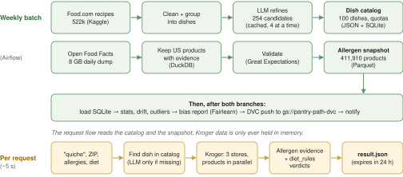

# Pantry Path: Data Pipeline Report

October 2026. This replaces the design draft from 2026-10-19.

## What we built

Pantry Path helps people with allergies and diets find groceries for a dish they want to cook. This report covers the data side. Someone types a dish, a ZIP code, the allergens they avoid and their diet. We return a `result.json` file with:

- the dish's ingredients
- the nearest grocery stores
- for each ingredient, products from those stores marked safe, unsafe or unknown, with a reason

What happens after that file (the final answer, the UI and the route) is built by other teammates. We trained no model in this phase. We did use an LLM to clean up the recipe data, but only before `result.json` is written, never to change its verdicts.

There are two parts. A weekly Airflow pipeline builds the reference data: a catalog of 100 dishes and an allergen snapshot of about 410,000 US grocery products. A request flow then answers one user at a time in a few seconds, using live Kroger data.

## How it works

The weekly DAG, `build_reference_data`, has two branches that run in parallel.

**Open Food Facts branch.** We download the daily 8 GB Parquet dump from Hugging Face. DuckDB filters it to the US products that list ingredients or allergens, and normalizes their barcodes to GTIN-13. It also drops products whose ingredient list isn't in English, because our diet rules only read English (about 0.5% of US products). The result is 410,009 products in a 30 MB file. We then delete the dump.

**Food.com branch.** We take 522,000 recipes from Kaggle, clean them and group them into dishes. We then pick 254 candidates: the most popular dishes for each cuisine, plus the 16 dishes from our golden recipe set.

Food.com turned out to be patchy in one specific way. It often leaves out the ingredient that defines a dish: lasagna noodles appear in only 2% of its lasagna recipes, and pie crust in none of its quiches. So each candidate goes through an LLM (Claude Opus 5.5) once, which:
- merges duplicate dishes and drops things that aren't dishes
- gives ingredients consistent names and marks them core or common
- adds the key ingredients the recipes left out
- assigns a cuisine

Of the 254 candidates, 215 survived, 31 were merged into another dish and 8 were dropped. We then keep 100 dishes with fixed cuisine quotas: 60 American, 10 European, 10 Latin American, 10 East or Southeast Asian, 5 South Asian and 5 Middle Eastern or African.

That LLM pass cost $6.08 in total. Every reply is saved and versioned. Later runs, ours or a teammate's, pull the saved replies and replay them, so nobody needs an API key and the catalog comes out the same every time.

After both branches finish, the DAG:
1. scores the catalog against held-out reference recipes and loads it into SQLite
2. computes statistics and checks for drift and outliers
3. writes the bias report
4. versions the outputs with DVC
5. sends a summary

**A request** looks the dish up in the catalog, finds the three nearest Kroger stores within 10 miles, and searches for each ingredient at each store in parallel. For every product, it checks Kroger's own allergen data first. If Kroger has none, it falls back to the Open Food Facts snapshot, matched by barcode. If neither source has an ingredient list, the product is marked unknown. Unknown is never shown as safe.

Here is a real example. The request was quiche near Cincinnati (45202), avoiding milk and gluten, for a vegetarian. It took 5.3 seconds and 38 Kroger calls, and found 3 stores and 180 products: 39 safe, 114 unsafe and 27 unknown. Only 4 of the 12 ingredients had a safe product. That's what you'd expect: bacon fails the vegetarian diet, the cheeses and cream contain milk, and the crust and flour contain gluten. Those gaps are listed in the file, so the final answer can suggest swaps.

## Where the data lives

| Output | What it is | Size |
|---|---|---|
| `off_products.parquet` | US products with ingredients or allergens, keyed by barcode | 30 MB |
| `dish_profiles.json`, `pantrypath.sqlite` | The 100-dish catalog (508 aliases, 1,171 ingredient rows) | under 0.5 MB |
| `llm_cache/` | The 254 saved LLM replies | 3.8 MB |

All three are versioned with DVC in a public Google Cloud Storage bucket (`gs://pantry-path-dvc`). Anyone can pull them over plain HTTPS without logging in. Only the pipeline's service account can write to the bucket. A version is about 35 MB, which stays inside the free tier, and a $5 budget alert is there in case that ever changes.

We store no Kroger data anywhere. Their API terms don't allow keeping copies, so product data only lives in memory during a request, and `result.json` expires after 24 hours.

## Data quality

We check both outputs with Great Expectations. The Open Food Facts suites run 12 checks, such as:
- every barcode has 13 digits and is unique
- every product has ingredients or allergen tags
- the row count is in the expected range

The latest run had no critical failures and one warning: 35 products where Open Food Facts reports a completeness score above 1. The catalog suites run 20 checks, covering things like dish count, cuisine quotas, at least three ingredients per dish and valid categories. None failed.

Each run also writes statistics that DVC can compare between versions, checks drift against the previous run, and flags outliers. The last run flagged 94 outliers: 87 very long ingredient lists and 7 dishes with an unusual number of ingredients. Problems are logged and emailed to the project address. We tested both kinds on 2026-10-26: the outlier check sent "WARNING: 94 outlier(s) found", and a step with a missing input sent "ERROR: step check-drift failed". Blocking problems fail the run. Warnings only alert. Anyone can get the alerts in their own inbox by putting a Gmail address and its app password in `.env` (see the README).

## Bias

Two parts of the pipeline make decisions that could serve some groups worse than others: which cuisines get dishes, and how our diet rules decide safe, unsafe or unknown. We sliced both with Fairlearn.

**The catalog.** A plain top 100 by popularity would have been almost entirely American or untagged. The cuisine quotas fix that:

| Cuisine | Plain top 100 | Our catalog |
|---|---|---|
| American | 1 tagged, 73 with no cuisine tag (mostly American) | 60 |
| European | 13 | 10 |
| Latin American | 7 | 10 |
| East and Southeast Asian | 4 | 10 |
| South Asian | 1 | 5 |
| Middle Eastern and African | 1 | 5 |

The quotas come with a trade-off. The added cuisines rest on less data: a median of 51 source recipes per dish, against 127 for American dishes.

**The diet rules.** We compared their verdicts with Open Food Facts' own vegan, vegetarian and gluten-free labels on a fixed sample of products. The labels were used only to score the rules, never as an input. Reading only the allergen tags left most products undecided. Adding the ingredient text, and checks on the product name and category, changed that:

| | Tags only | Full rules |
|---|---|---|
| Products the rules couldn't decide | 77% | 0.6% |
| Labelled-safe products confirmed safe | 0% | 96% |
| Unsafe products wrongly called safe | 0.0% | 0.4% |

The gaps that remain are small. Bakery and cereal products are left undecided more often than pantry condiments (2.9% against 0.1%), and so are frequently scanned products (1.8% against 0.6% for products never scanned).

These numbers have known limits. We adjusted the rules after looking at mismatches with the same labels, so this isn't a held-out test and the accuracy is likely a little optimistic. The labels themselves are noisy; some "vegan" products list eggs. The full report is in `data-pipeline/reports/bias_report.md`. The next section adds a held-out check.

## Held-out evaluation

Both things the pipeline decides are now also scored on data nobody looked at while building them.

**The catalog against reference recipes.** We split our hand-written recipes in two. The dev split is the 16 golden recipes we used while building the pipeline, so its score is optimistic. The test split is 27 recipes for other catalog dishes, written after the catalog was frozen. The catalog is replayed from saved LLM replies, so these recipes couldn't have shaped it. A new DAG task, `eval_catalog`, checks how many of each recipe's ingredients the dish profile lists. Salt, pepper and water don't count, since the catalog leaves them out on purpose. We tuned the name matching on the dev split only.

| Split | Dishes | Ingredients found | Without the LLM's additions | Fully covered dishes |
|---|---|---|---|---|
| Dev (used while building) | 16 | 91.1% | 87.9% | 7 |
| Test (held out) | 27 | 89.8% | 86.4% | 13 |

The held-out score is close to the dev score, so the catalog holds up on dishes we never checked by hand. The LLM pass adds about 3 points on unseen dishes. Most misses are recipe variants, like chicken thighs where the catalog lists breasts. A few are naming differences, like "breadcrumbs" versus "bread crumbs". We didn't fix those after seeing the test split, so 89.8% is a lower bound. Held-out recall below 75% sends an alert.

**The diet rules on new products.** The rules were tuned on every labelled product in the 2026-10-24 snapshot, so none of those products can be held out. We froze their 411,910 barcodes. Each run now also scores the labelled products that a newer Open Food Facts snapshot adds. Nobody has looked at those, so they form a true held-out test. The set is empty for the frozen snapshot and grows with every weekly download.

We tried it on the 2026-10-26 dump, two days later, and it caught a problem straight away. Of the 231 new products, 98 had Norwegian ingredient text. The rules only read English, so 19% of held-out verdicts came back unknown, never safe. That's why the snapshot now keeps English ingredient lists only. With that rule, the same dump has 40 new labelled products (47 verdicts): none left unknown, no unsafe product called safe, and every verdict matched the label. That's still a small sample, and it will grow with every weekly snapshot.

## Making it faster

We ran the same pipeline two ways and compared the Gantt charts in Airflow. In the first run, every task went one after another. Refining 254 dishes one at a time took most of that run, and the 2-minute download held everything else up. In the second run, the two branches ran side by side and four dishes were refined at once.

| Run, same data | Wall time | Biggest step |
|---|---|---|
| One task at a time | 11.2 min | refining dishes, 6.5 min |
| Parallel | 4.6 min | the download, now overlapping the refining |

Both runs replayed the saved LLM replies. With live LLM calls, the gain is larger: the 253 real calls took 5.3 minutes four at a time, and would have taken about 20 minutes one by one. The bias report, at 1.5 minutes, is now the slowest step at the end of the chain.

## Reproducing it

You need Docker, the repo and the Airflow UI. Start Airflow with `docker compose up` in `data-pipeline/` and switch on `build_reference_data`. No API keys are needed, because the DAG pulls our saved LLM replies instead of calling the LLM.

We tested exactly that on a fresh copy of the repo on 2026-10-25. All 271 tasks finished green in 4 minutes, and the catalog was identical to ours. The step-by-step guide, with the results you should see, is in `data-pipeline/README.md`.

The code has 734 unit tests that need no network access. A GitHub Actions workflow runs them, along with a lint check, on pushes and pull requests.

## Decisions we made

- **No Kroger data is stored**, because their terms forbid it.
- **The catalog has ingredients only, no quantities.** Food.com quantities have no units, and amounts belong in the final answer.
- **Allergen evidence comes from the store first, then Open Food Facts.** In a sample, 92% of Kroger products had their own allergen data, and 99% of Kroger barcodes were in Open Food Facts.
- **One set of diet rules (`shared/pantrypath_core`)** is used by both the pipeline and the backend, so they always agree.
- **The LLM step ran once and is replayed.** That keeps the catalog stable and free to rebuild.

## What's still open

- **Kroger's daily API limit isn't verified.** It's reported as 10,000 calls, which would be about 260 requests a day.
- **Target fallback (RedCircle):** experimental. Its storage terms aren't verified, and its search results have no barcodes.
- **Food.com's license isn't confirmed**, so we don't redistribute the raw recipes.
- **No quantities, prices, nutrition, or medical and religious diets** in this version.
- **The catalog has some odd cases.**
  - Caesar salad is filed as Latin American; it was invented in Tijuana.
  - Several "Latin American" and "East Asian" dishes are American adaptations, like taco casserole and General Tso's chicken.
- **Dishes outside the catalog** need an LLM key at request time.

For how to use the output, see `docs/data-pipeline-handoff.md`. To run or change the pipeline, see `data-pipeline/README.md`.
