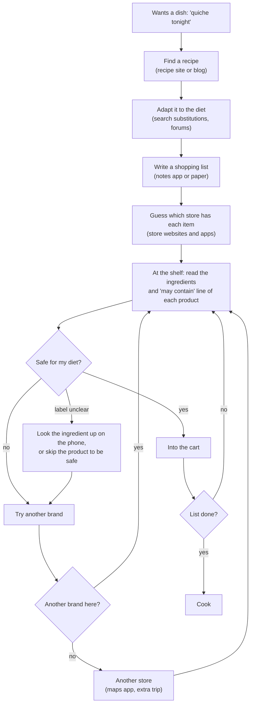

# Pantry Path - Project Summary

Pantry Path: a conversational food finder for special diets. Project Team 11.

Team members:
- Ansh Manoj Kanungo
- Kenil Prafulbhai Devani
- Khushal Bharatkumar Trivedi
- Shivu Donmardi Gorva
- Tirth Ghanshyambhai Borasaniya

Conversational assistant that turns "I feel like quiche tonight" into a diet-safe
shopping list, store availability, and an optimized multi-stop route - in one chat.

## Problem
People with special diets (allergies, celiac, pregnancy, medical, religious, lifestyle)
can't just buy groceries normally. Recipe → substitutions → label checks → store search →
route planning today means juggling 4-5 disconnected tools.

### How people shop for special diets today

Where it hurts:
- **Every product, every trip.** Labels change, so the shelf check (F to J) repeats on every
  visit, and an unclear label is a guess: either risk it or give up the product.
- **No tool sees the whole job.** The recipe site doesn't know the diet, the store app
  doesn't know the recipe, and the maps app doesn't know which store has a safe version.
- **Failures surface late.** You only learn a store has no safe option once you're
  standing in it, which is what forces the extra trips.

Pantry Path covers B to L in one chat: the recipe is adapted to the diet, products are
checked by rules with their evidence shown, unclear products are marked unknown instead
of safe, and the stores with safe options are known before anyone leaves home.

## Approach
- A self-hosted open-weight LLM (for example Qwen2.5-7B-Instruct or Llama 3.1 8B Instruct)
  interprets the conversation and adapts the recipe. We start with prompting and structured
  output, and fine-tune only if our evaluations show it is needed.
- Deterministic rules decide diet safety - the model never decides what's safe to eat.
- Background search starts as soon as the user starts chatting, so results are ready
  seconds after confirmation. A session cache means changing your mind never repeats a search.
- Every product gets an evidence grade (certified label → structured data → nutrition
  panel → name only → unknown). Unknown is never shown as safe.

## Model and LLMOps
- Data: RecipeNLG and Food.com recipes, plus our own diet-adaptation and evaluation sets,
  split into train/validation/test by recipe.
- Held-out evaluation sets, started in the data pipeline phase: reference recipes in a dev
  split (16, used while building) and a held-out test split (27, written after the catalog
  was frozen), scored against the dish catalog on every run; and a test set for the diet
  rules that grows every week (labelled Open Food Facts products added after the rules were
  frozen). The held-out recipes are the starting point for the model's test set.
- Versioned data (for example DVC) and a model and prompt registry (for example MLflow).
- Staged releases (dev → staging → production) with rollback.
- Monitoring of model quality: valid output, parsing accuracy, latency and drift.

## Data sources
RecipeNLG and Food.com (recipes for the model), Open Food Facts (ingredients/allergens),
USDA FoodData Central (nutrition), Kroger API (live stock/price), OpenStreetMap services
(stores, geocoding, routing).

## Scope
**In:** chat-driven recipe adaptation, self-hosted model with evaluations, diet rule engine,
shopping list, store list with evidence grading, multi-stop route, session cache.
**Out (for this phase):** accounts, payments, native apps, multi-meal planning, follow-up
edits such as "keep it cheap" or "only one store".

## Timeline
- Phase 1 (Oct 3 - Nov 1): core app, first diet rules, model selection and baseline evaluation,
  first version of the data pipeline
- Phase 2 (Nov 2 - Dec 1): all diet categories, full list/store/route output, fine-tuning if
  needed, LLMOps (registry, staged release, monitoring)
- Final week (Dec 2 - Dec 8): feature freeze, final evaluation, rehearsals, final presentation

## Success criteria
No product shown breaks a recorded diet rule. The model meets the quality targets we set after
the baseline evaluation. The demo scripts run reliably. Everything runs within our project budget.
